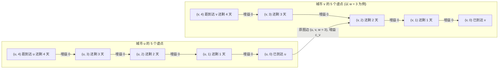

[[TOC]]

## 形式化题目

给定一张包含 $n$ 个点、$m$ 条有向边的图（无自环，允许重边），每条边 $(u, v, w)$ 具有通行耗时 $w \in [1, 5]$。
每个点 $i$ 具有常态权值 $c_i$。每次到达点 $i$（包括第 $0$ 天起点以及后续到达），都会获得愉悦值 $c_i$ 并必须立即沿某条出边离开，不能在途中停留。
给定 $k$ 次临时增益活动 $(t_i, x_i, y_i)$，表示如果在第 $t_i$ 天恰好到达点 $x_i$，可以额外获得愉悦值 $y_i$。
求从点 $1$ 出发（第 $0$ 天），恰好在第 $T$ 天回到点 $1$ 的最大愉悦值之和。若无法在第 $T$ 天回到点 $1$，输出 $-1$。

## 暴力解法

### 思路

不考虑 $T \le 10^9$ 的巨大天数，先建立最直接的状态转移方程。

定义 $dp(t, u)$ 表示在第 $t$ 天恰好到达城市 $u$ 所能获得的最大愉悦值之和。
因为通行每条边需要花费 $w$ 天，所以第 $t$ 天到达城市 $v$ 必然是在第 $t-w$ 天从某个城市 $u$ 沿边 $(u, v, w)$ 出发。
因此状态转移方程为：
$$dp(t, v) = \max_{(u, v, w) \in E, t \ge w} \{ dp(t-w, u) \} + c_v + (\text{若第 } t \text{ 天在 } v \text{ 存在美食节，加上 } y)$$

- 初始状态：$dp(0, 1) = c_1$，其余均为 $-\infty$。
- 空间优化：因为 $w \le 5$，第 $t$ 天的状态仅依赖于 $t-5 \sim t-1$ 天的状态，可以通过对天数模 $6$ 进行滚动数组压缩，空间复杂度仅为 $O(n)$。

### 代码

@include-code(./brute.cpp, cpp)

### 复杂度

- **时间复杂度**：每一天需要遍历所有 $m$ 条边，共转移 $T$ 天，时间复杂度为 $O(T \cdot m)$。
- **空间复杂度**：由于采用模 $6$ 的滚动数组保存最近 $6$ 天的状态，空间复杂度为 $O(n)$。

### 瓶颈

在题目中 $T \le 52501$ 的测试点中，该暴力动态规划可以在时限内通过。但题目满分数据中 $T \le 10^9$。此时外层天数循环次数达到 $10^9 \times 500 = 5 \times 10^{11}$ 次计算，无法在时限内跑完。

瓶颈在于：虽然总天数 $T$ 极大，但图的结构和绝大部分时间内的转移规则是恒定不变的（美食节只有 $k \le 200$ 次）。我们需要将线性按天递推加速为对数级转移。

## 正解

### 思路

#### 1. 广义矩阵乘法与 $(\max, +)$ 半环

在没有美食节时，考虑转移方程的形式：
$$dp(t, v) = \max_{u} \{ dp(t-1, u) + \text{边权} \}$$
这与经典矩阵乘法 $C_{i, j} = \sum_{k} (A_{i, k} \times B_{k, j})$ 的结构完全同构，只需将标量加法替换为取最大值 $\max$，标量乘法替换为普通加法 $+$。
在该代数系统（称为 $(\max, +)$ 半环）中：
- 矩阵乘法定义为：$(A \times B)_{i, j} = \max_{k} \{ A_{i, k} + B_{k, j} \}$；
- 该矩阵乘法同样满足结合律 $(A \times B) \times C = A \times (B \times C)$；
- 零元为 $-\infty$，乘法单位元 $I$ 为对角线上全为 $0$、非对角线全为 $-\infty$ 的对角矩阵。

下表逐项对照 $(\max, +)$ 矩阵乘法与经典矩阵乘法的符号角色, 从上往下每一行都是一次符号替换, 对照着看就能把上面的转移式直接写成矩阵乘法:

| 符号角色 | 经典矩阵乘法 | $(\max, +)$ 矩阵乘法 |
| --- | --- | --- |
| 求和号 $\sum$ 处的合并运算 | 加法 $+$ | 取最大值 $\max$ |
| 相乘处的标量运算 | 标量乘法 $\times$ | 标量加法 $+$ |
| 零元 | $0$ | $-\infty$ |
| 乘法单位元 $I$ | 对角线全 $1$、其余全 $0$ | 对角线全 $0$、其余全 $-\infty$ |

整张表其实只有两个替换: 求和号处的 $+$ 换成 $\max$, 相乘处的 $\times$ 换成 $+$, 其余结构原样照搬. 于是经典矩阵乘法的结合律在新系统中原样成立, 矩阵快速幂的正确性不需要重新证明. 零元 $-\infty$ 表示不可达: 任何值与 $-\infty$ 相加仍是 $-\infty$, 无效路径永远不会混进 $\max$. 乘法单位元对角线取 $0$ 而不是 $1$, 是因为「什么都不走」贡献的愉悦值恰好是 $0$.

#### 2. 边权 $1 \le w \le 5$ 的拆点技巧

由于有向边的通行时间 $w \in [1, 5]$ 不全为 $1$，不能直接在原图的邻接矩阵上做转移。
注意到 $w$ 极小（最大仅为 $5$），我们可以使用经典的**拆点法**将非单位权有向图转化为等价的单位权图：
将原图中的每个城市 $u$ 拆为 $5$ 个虚点 $(u, 0), (u, 1), (u, 2), (u, 3), (u, 4)$，其中状态 $(u, j)$ 表示“当前位于正在前往城市 $u$ 的途中，距离真正到达还剩 $j$ 天”：
1. **内部连边**：对 $j \in [1, 4]$，建立转移 $(u, j) \to (u, j-1)$，转移增益为 $0$。这表示每过一天，距离到达城市 $u$ 就少一天；
2. **原图有向边**：对于原图中的有向边 $(u, v, w)$，小 W 在到达城市 $u$（即状态 $(u, 0)$）时决定沿该边出发，耗时 $w$ 天到达 $v$。这相当于经过 $1$ 天后，状态进入 $(v, w-1)$，并在最终到达时收获 $c_v$ 愉悦值。因此建立转移 $(u, 0) \to (v, w-1)$，转移增益为 $c_v$（若存在重边，取最大的 $c_v$ 即可）。

下图把城市 $u$ 的 5 个虚点画成一组, 展示拆点产生的两类转移边(以一条原图边 $(u, v, w = 3)$ 为例), 重点看每条边旁标注的增益:

每组内的链是内部边 $(u, j) \to (u, j-1)$, 每走一步恰好过 1 天且增益为 $0$, 所以 $(u, 0)$ 就表示真的到达了 $u$. 跨组边从 $(u, 0)$ 出发, 却落在 $(v, w-1)$ 而不是 $(v, 0)$: 出发后还要沿 $v$ 的内部链再走 $w-1$ 天才真正到达 $v$. 增益 $c_v$ 挂在跨组边上, 内部链增益恒为 $0$, 这样每到达一座城市就恰好计入一次 $c_v$, 不会因等待天数被重复计算.

拆点后，新图的点数变为 $N = 5n \le 250$。此时所有的转移都是跨越恰好 $1$ 天的单位转移，可以完整写成一个 $N \times N$ 的一步转移矩阵 $M$。

#### 3. 美食节划分与向量乘矩阵优化

图中有 $k \le 200$ 次美食节。我们将所有美食节按时间升序排序为 $t_1 \le t_2 \le \dots \le t_k$，并令 $t_0 = 0$。
整个时间轴被切分为最多 $k+1$ 个连续的无美食节区间 $[t_{i-1}, t_i]$：
- 在区间 $(t_{i-1}, t_i)$ 内，转移完全等价于乘以 $M^{\Delta t}$（其中 $\Delta t = t_i - t_{i-1}$）；
- 到达第 $t_i$ 天后，将对应美食节城市 $x_i$ 的状态加上额外愉悦值 $y_i$（若该状态当前可达）。

如果对每个区间都重新计算矩阵幂 $M^{\Delta t}$，每次计算需要 $O(N^3 \log \Delta t)$，总复杂度为 $O(k N^3 \log T)$，计算量接近 $200 \times 30 \times 250^3 \approx 9.3 \times 10^{10}$，依然无法通过。

**关键优化**：
我们并不需要维护完整的 $N \times N$ 状态矩阵，而只需要维护一个 $1 \times N$ 的行向量 $F$（其中 $F_j$ 表示当前天到达状态 $j$ 的最大愉悦值）。
行向量乘以矩阵的复杂度仅为 $O(N^2)$。
因此：
1. 在开头预处理出矩阵的倍增幂 $M^{2^0}, M^{2^1}, \dots, M^{2^{29}}$，共需 $30$ 次矩阵相乘，耗时 $O(N^3 \log T)$；
2. 转移每一段 $\Delta t$ 时，将 $\Delta t$ 拆为二进制位，每一位对应一次**行向量乘以预处理好的矩阵**，耗时仅 $O(N^2)$；
3. 总共只需要进行 $(k+1) \log T$ 次向量乘矩阵，计算量降至 $200 \times 30 \times 250^2 \approx 3.75 \times 10^8$ 次运算，配合非负剪枝后可以在时限内轻松通过。

### 代码

@include-code(./main.cpp, cpp)

### 复杂度

- **时间复杂度**：
  - 预处理矩阵倍增幂：计算 $\log T \approx 30$ 次 $N \times N$ 矩阵相乘，耗时 $O(N^3 \log T) = O((5n)^3 \log T)$；
  - 美食节按时间排序：$O(k \log k)$；
  - 跨越 $k+1$ 段区间的向量转移：共进行最多 $(k+1) \log T$ 次向量乘矩阵，每次耗时 $O(N^2)$，总耗时 $O(k N^2 \log T) = O(k (5n)^2 \log T)$；
  - 总时间复杂度为 $O((5n)^3 \log T + k (5n)^2 \log T)$。当 $n = 50, k = 200, T = 10^9$ 时，$N = 250$，常数较小且稀疏剪枝，运行时间在 0.5 秒左右，完全满足时限要求。
- **空间复杂度**：
  - 存储 $30$ 个 $250 \times 250$ 的 `long long` 转移矩阵，空间占用约为 $30 \times 250 \times 250 \times 8 \text{ Bytes} \approx 15 \text{ MB}$；
  - 辅助向量和美食节数组空间为 $O(5n + k)$；
  - 总空间复杂度为 $O(N^2 \log T) = O((5n)^2 \log T)$，远小于题目限制的 512 MB。

## 总结

本题的关键在于两个核心转化的有机结合：
1. **拆点降维**：利用边权 $w \le 5$ 的限制，将每座城市拆成 5 个等待状态，将带权边转化为单位步长的状态机转移，从而使问题能够套用矩阵快速幂；
2. **向量乘法降阶**：利用状态只需要从起点单向推进的特点，将 $k$ 段区间的全矩阵快速幂优化为“预处理矩阵倍增幂 + 向量右乘”，把瓶颈项的复杂度从 $O(k N^3 \log T)$ 降为 $O(k N^2 \log T)$。
