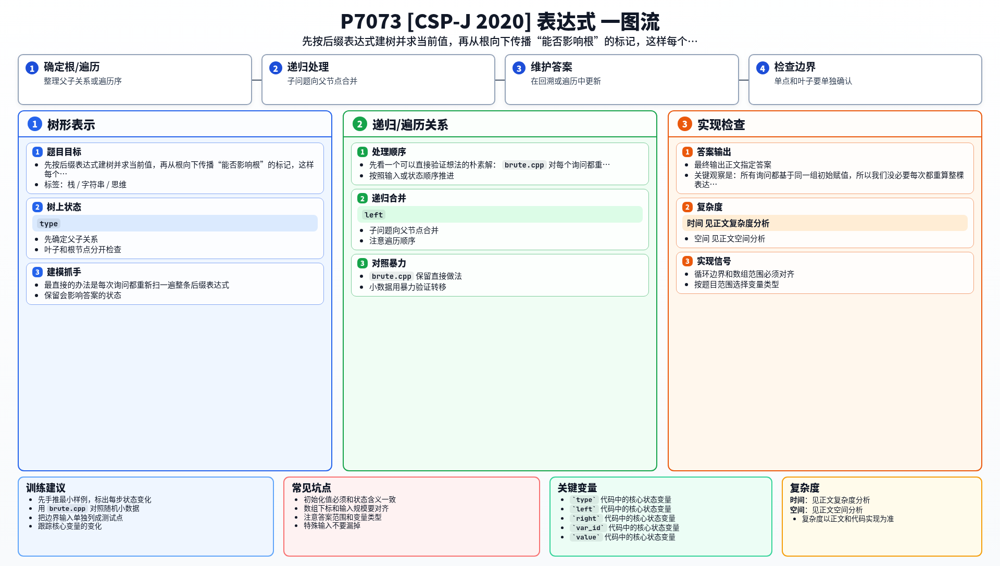

[[TOC]]

## 形式化题目

给定一个后缀表达式：操作数是变量 $x_1, x_2, \dots, x_n$，每个变量在表达式中恰好出现一次；运算符只有 `&`（与）、`|`（或）、`!`（取反）三种，按后缀式的规则从左往右计算，括号内的子表达式先算。

每个变量有一个初始取值 $0$ 或 $1$。共有 $q$ 次询问，每次给出一个下标 $k$：把 $x_k$ 的值取反——这是临时修改，不影响后续询问——求此时整个表达式的值，每次输出一个 $0$ 或 $1$。

## 解法路线

题面「数据规模与约定」给出四个真实档位，每一档都指向一种做法：

| 档位 | 真实约束 | 做法 | 瓶颈 |
| --- | --- | --- | --- |
| $20\%$ | 只含 `&`，或只含 `\|` | 同种运算满足结合律，整式退化成「全与 / 全或」，数 $1$ 的个数 | 只对单一种运算成立 |
| 另 $30\%$ | $\|s\|, q, n \leqslant 1000$ | 每次询问重新求值 | $O(\|s\| \cdot q)$，小数据才够 |
| 另 $20\%$ | 初值全为 $0$ 或全为 $1$ | 化归成「翻转能不能传到根」，两遍 DFS | 算法已无瓶颈，剩下 $10^6$ 级的实现问题 |
| $100\%$ | $\|s\| \leqslant 10^6$，$q \leqslant 10^5$，$n \leqslant 10^5$ | 同上一层，补上读入、树深、内存的处理 | — |

正文按「先暴力、再特例、最后正解」的顺序讲：**暴力（另 30%）→ 只有一种运算（20%）→ 初值全同（20%）→ 正解（100%）**。

前两层是各自独立的特例观察，正解不依赖它们；第三层给出本题的核心观察，正解与它共用同一套算法，区别只在 $10^6$ 级数据下的实现。正式主解是 `main.cpp`。

## 暴力解法：每次询问重算

### 适用范围

题面「另外 30%」的数据：$|s| \leqslant 1000$，$q \leqslant 1000$，$n \leqslant 1000$。

### 思路

后缀表达式求值是栈的标准应用，一趟扫描即可：

- 读到变量 `x_i`：把它的当前取值入栈；
- 读到 `!`：弹出一个值，取反后压回；
- 读到 `&` 或 `|`：弹出两个值（先右后左），算完压回。

扫描结束后栈里唯一的值就是表达式的值。每个询问先把 $x_k$ 取反，再把整条表达式重算一遍，栈顶即答案。

### 代码

@include-code(./brute.cpp, cpp)

### 复杂度与瓶颈

每次询问 $O(|s|)$，$q$ 次共 $O(|s| \times q)$。30% 档是 $1000 \times 1000 = 10^6$，轻松；100% 档是 $10^6 \times 10^5 = 10^{11}$，必超时。

瓶颈在于：除了被取反的那一个变量，所有询问的求值过程完全相同，重复计算占了绝大多数。

## 子任务解法：只有与运算或只有或运算

### 适用范围

题面第一个「对于 $20\%$ 的数据」：表达式中有且仅有与运算（`&`）或者或运算（`|`），既不混用，也不含 `!`。

### 思路

两个条件合起来就足够了：

1. 每个变量在表达式里恰好出现一次；
2. 全部二元运算符是同一种，而 `&`、`|` 都满足结合律与交换律。

于是无论表达式树长成什么形状，算出来的结果都等于对全部 $n$ 个变量做同一种运算：

| 运算符 | 整式的值 |
| --- | --- |
| 只有 `&` | 所有变量都是 $1$ 时才是 $1$ |
| 只有 `\|` | 至少有一个变量是 $1$ 就是 $1$ |

所以不必建树：数出初值里 $1$ 的个数 `ones`，翻转 $x_k$ 后新的个数是 $ones - v_k + (1 - v_k)$，再按上表判断，每次询问 $O(1)$。

代码里只需要从输入中认出是哪一种运算符，表达式结构本身可以整段跳过。

### 代码

@include-code(./subtask_and_or.cpp, cpp)

### 复杂度与瓶颈

时间 $O(|s| + n + q)$（读表达式 + 统计 + 回答），空间 $O(n)$。

瓶颈：结论完全依赖「只有一种运算」。一旦 `&`、`|` 混用或出现 `!`，结合律就断了——例如 `!x1` 会让 $x_1$ 的贡献不再对称，光数个数就不够。所以这一档拿不到 100% 的分。

## 子任务解法：初值全为 0 或全为 1

### 适用范围

题面「另外 20%」：所有变量的初值相同（全 $0$ 或全 $1$），其余约束仍是 100% 档的规模，即 $|s|$ 可以到 $10^6$、$q$ 可以到 $10^5$。

### 思路

**第一步：把问题化归。**

初值全同时，整个表达式算出来是一个常数 $V$。一次询问只翻转一个变量，所以根的值只有两种可能：跟着翻成 $\neg V$，或者原地不动仍是 $V$。于是每次询问真正在问的是：

> 这个变量的翻转，能不能一路传到根？

这一步与初值究竟是 $0$ 还是 $1$ 无关，可以对所有询问统一预处理一次。

（顺带说明：这个化归对任意初值其实都成立；题面把它单列成一档，是因为全同初值下 $V$ 是常数，「答案只有 $V$ 和 $\neg V$ 两种」一眼可见，观察最容易落地。）

**第二步：把后缀表达式建成树。**

后缀表达式天然对应一棵表达式树，用栈就能建出来：

- 遇到变量 `x_i`：建一个叶子节点，节点编号入栈；
- 遇到 `!`：弹出栈顶节点当孩子，建非门节点入栈；
- 遇到 `&` 或 `|`：弹出两个节点（先右后左），建对应节点入栈。

最后栈底剩下的就是根。拿样例 `x1 x2 & x3 |` 走一遍：

```text
读 x1 → 栈: [1]             节点1 = x1
读 x2 → 栈: [1, 2]          节点2 = x2
读 &  → 弹出 2、1 → 栈: [3]  节点3 = &，左孩子 1，右孩子 2
读 x3 → 栈: [3, 4]          节点4 = x3
读 |  → 弹出 4、3 → 栈: [5]  节点5 = |，左孩子 3，右孩子 4
```

得到的节点 5 就是根，它的左孩子是 `&` 节点，右孩子是 `x3`。

**第三步：自底向上求一遍值。**

`dfs1(u)` 递归算出每个节点的当前值：叶子取变量初值，非门取反，与门、或门按左右孩子的值算。这趟结束时根节点的值就是原表达式的值 $V$。

**第四步：自顶向下传播「能否影响根」。**

`dfs2(u, about)` 中的 `about` 表示：当前节点 $u$ 的值发生变化时，会不会影响根。传播规则只有三条：

| 门 | 传递条件 |
| --- | --- |
| `!` | 永远原样传给孩子——取反是可逆的，孩子变了它一定变 |
| `&` | 只有当**另一个**孩子当前值为 $1$ 时才传 |
| `\|` | 只有当**另一个**孩子当前值为 $0$ 时才传 |

二元门这两条正是短路：`0 & x` 已经被那个 $0$ 卡死，`1 | x` 已经被那个 $1$ 卡死，另一边怎么翻都无济于事；只有没被卡死的一侧，变化才穿得过去。

可以把 `about` 想成一根从根放下来的**绳子**，每个门要么让绳子过去，要么把它剪断：`!` 永远放行，`&` 只有另一边是 $1$ 才放行，`|` 只有另一边是 $0$ 才放行。绳子最后连到某个变量叶子上，就说明翻转这个变量能改变根。

**第五步：回答询问。**

叶子上记下的 `can_affect` 就是最终答案。因为只有一个变量被翻转、其余都没动，能影响根时根值一定取反，不能影响时根值一定不变：

```text
can_affect[x_k] ? 输出 V ^ 1 : 输出 V
```

### 代码

本层不单独给出代码：算法与正解完全相同，实现见下文正解的 `main.cpp`。

### 复杂度与瓶颈

建树、求值、影响传播都是线性的，预处理 $O(|s|)$，每个询问 $O(1)$，总复杂度 $O(|s| + q)$，空间 $O(|s|)$。

瓶颈已经不在算法上，而在实现上：$|s|$ 到 $10^6$ 时读入怎么写、节点开多大、表达式退化成链时递归会不会爆栈——这些留给正解。

## 正解

### 关键观察

算法在上一层已经写完，100% 档的新问题全在规模上：

- **读入**：$|s|$ 达 $10^6$，不能先读整行再切分，用 `cin >> tok` 流式读 token 即可；读到第一个纯数字时它就是 $n$，表达式到此结束。
- **节点数**：节点数 = 变量数 + 运算符数 $= O(|s|)$，用静态大数组 `node[]`，按 `++node_cnt` 递增编号分配（数组 + 分配指针的动态化静态写法）。
- **树深**：链状表达式（如 `x1 x2 & x3 & x4 & ...`）的深度是 $O(|s|)$，`dfs1` / `dfs2` 是递归，深度极端时有爆栈风险，必要时可换成显式栈的迭代写法；本实现按评测环境的栈空间直接递归。
- **询问**：$q$ 到 $10^5$，必须 $O(1)$，靠 `var_node[x] → can_affect[]` 查表，不再碰表达式。

### 思路

对应代码的五个部分：

1. `init_tokens()`：流式读入后缀表达式的 token，遇到第一个数字就拿到 $n$ 并结束；
2. `build_tree()`：按上一层第二步的栈规则建树，`var_node[id]` 记下每个变量对应的叶子节点，返回根编号；
3. `dfs1(root)`：自底向上求出每个节点的当前值，根值记为 `root_val`；
4. `dfs2(root, true)`：自顶向下按三条短路规则标 `can_affect[]`；
5. 询问阶段只查表：能影响根就输出 `root_val ^ 1`，否则输出 `root_val`。

### 代码

@include-code(./main.cpp, cpp)

### 复杂度

时间复杂度 $O(|s| + q)$，空间复杂度 $O(|s|)$。

## 总结

这题的难点不在后缀表达式本身，而在看出「翻转一个变量是否有用」可以预处理。把「每次重算整式」改成「先判断哪些变量能影响根」，复杂度就从 $O(|s| \times q)$ 降到 $O(|s| + q)$。

另一个重要的思维是**短路传播**：二叉树中一个节点的值是否受某个子树影响，往往取决于另一棵子树的值。「一边卡死另一边」的模式在表达式求值、决策树剪枝里都很常见。

四个分数档位串起来是一条「从重复计算到预处理」的路线：每次重算整条式子 → 结构特殊时直接看出答案 → 把重算变成影响标记 → 在 $10^6$ 规模上把它落地。真正需要记住的只有那三条短路规则。

## 图示解析

这张图把本题的建模、关键转移、实现检查和训练方法压缩到一页，适合读完正文后复盘。


