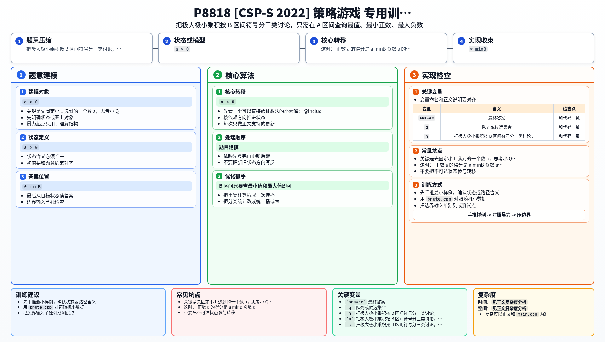

[[TOC]]

## 形式化题目

给定长度为 $n$ 的数组 $A$ 和长度为 $m$ 的数组 $B$。

给出 $q$ 次独立询问，每次询问给出两个区间 $[l_1, r_1]$ 和 $[l_2, r_2]$。
游戏规则如下：
1. 先手小 L 首先在 $A[l_1 \dots r_1]$ 中选择一个下标 $x$；
2. 后手小 Q 在知晓小 L 的选择后，在 $B[l_2 \dots r_2]$ 中选择一个下标 $y$；
3. 双方最终得分为 $A_x \times B_y$。小 L 希望得分尽可能大，小 Q 希望得分尽可能小。

假设双方均采用绝顶聪明（最优）的策略，求每次博弈的最终得分。

---

## 暴力解法

### 思路

枚举小 L 选哪个 $x$，再枚举小 Q 选哪个 $y$，对每个 $x$ 求小 Q 能压到的最小得分，最后取最大值。

### 代码

@include-code(./brute.cpp, cpp)

### 复杂度

单次询问耗时 $O(|A| \times |B|)$，在 $n, m, q \leqslant 10^5$ 规模下总复杂度高达 $10^{10}$ 级别，必然超时。

---

## 正解：博弈极值对抗与候选点统一模型

许多解法会在此处根据 $B$ 区间“全正、全负、有正有负”展开长达数十行的多重 `if-else` 分类讨论。但如果站在**极值对抗统一模型**的高度，就会发现后手的反应公式与先手的候选点具有天然的统一性，完全无需任何分类！

### 1. 后手最优反应的确定性公式

假设小 L 已经选出了数值 $x$：
- 若 $x > 0$：为了让乘积尽量小，小 Q 一定会选 $B$ 区间里的**最小值** $\min B$；
- 若 $x < 0$：为了让乘积尽量小，小 Q 一定会选 $B$ 区间里的**最大值** $\max B$；
- 若 $x = 0$：不论小 Q 选什么，乘积恒为 $0$。

注意观察：当 $x > 0$ 时必有 $x \cdot \min B \leqslant x \cdot \max B$；当 $x < 0$ 时必有 $x \cdot \max B \leqslant x \cdot \min B$。
因此，**无论 $x$ 是正、是负还是零，小 Q 的最优反应公式可以严格统一为**：
$$
f(x) = \min(x \cdot \min B,\; x \cdot \max B)
$$
这个式子完美囊括了小 Q 的全部博弈逻辑，没有任何例外情况！

### 2. 先手有价值的候选点至多只有 5 个

在已知小 Q 反应函数 $f(x)$ 的前提下，小 L 在 $A$ 区间内真正值得考虑的数值其实极少：
- **正数集合**：小 Q 会乘上 $\min B$。
  - 若 $\min B \geqslant 0$，系数为非负，$x$ 越大越好 $\implies$ 候选为最大正数（即 $\max A$）；
  - 若 $\min B < 0$，系数为负，$x$ 越小越好 $\implies$ 候选为最小正数（记为 $\operatorname{pos\_min}(A)$）；
- **负数集合**：小 Q 会乘上 $\max B$。
  - 若 $\max B \leqslant 0$，系数为非正，$x$ 越小绝对值越大 $\implies$ 候选为最小负数（即 $\min A$）；
  - 若 $\max B > 0$，系数为正，$x$ 越大越接近 0 $\implies$ 候选为最大负数（记为 $\operatorname{neg\_max}(A)$）；
- **零元素**：若 $A$ 区间内存在 $0$，小 L 始终可以选 0 保底获得 $0$ 分。

**结论**：小 L 的最优决策点 $x^*$，必然落在以下至多 5 个候选点集合中：
$$
\text{cands} = \{\max A,\; \min A,\; \operatorname{pos\_min}(A),\; \operatorname{neg\_max}(A),\; 0\}
$$

### 3. 极小化极大（Minimax）统一求解

一次查询只需做两步：
1. 用 ST 表查出 $B$ 区间的 $\min B$ 与 $\max B$；
2. 提取 $A$ 区间真实存在的上述 5 个候选值，代入统一反应公式取全局最大值：
   $$
   \text{Ans} = \max_{x \in \text{cands},\; x \text{ 存在}} \min(x \cdot \min B,\; x \cdot \max B)
   $$

查询函数仅需十余行，没有任何复杂的符号分类嵌套分支！

---

## 代码实现

维护 6 张 ST 表（$A$ 的 4 个最值、$B$ 的 2 个最值）与一个判断 0 存在的前缀和数组：

@include-code(./main.cpp, cpp)

---

## 复杂度分析

- **预处理复杂度**：构建 6 张 ST 表耗时 $O((n + m) \log(n + m))$，空间复杂度 $O((n + m) \log(n + m))$；
- **单次询问复杂度**：常数次 ST 表查询与 5 次候选值代入，时间复杂度严格为 $O(1)$；
- **总时间复杂度**：$O((n + m) \log(n + m) + q)$。

---

## 总结

1. **从分类讨论到模型统一**：
   传统题解的分类讨论容易遗漏边界，而本解法通过写出后手的统一极值函数 $\min(x \cdot \min B, x \cdot \max B)$，直接将双人博弈化简为单变量在有限极值点集上的优化问题；
2. **极小化极大的典型降维**：
   通过分析单调性，将无穷的连续选择空间或 $O(n)$ 的离散区间搜索，直接缩减为 5 个关键代表元，展现了博弈论在算法竞赛中的数学之美。

---

## 图示解析

下图把本题博弈对抗关系、区间极值维护与候选点提取压缩在一页，供复盘参考：

