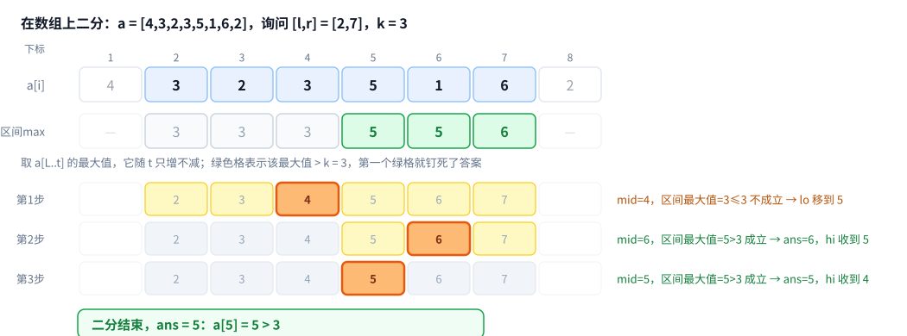
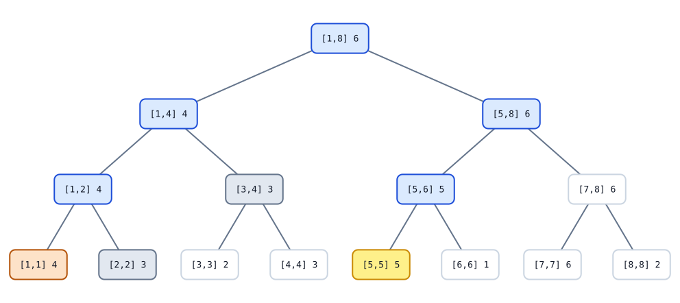

[[TOC]]

## 形式化题目

给定长度为 $n$ 的数列 $a$ 和 $m$ 个三元组询问 $(l,r,k)$, 对每个询问求

$$
\min\{\,i \mid l\leqslant i\leqslant r,\ a_i>k\,\}
$$

若该集合为空则回答 $-1$.

## 解法路线

题目给了三档测试点: 第 $1$ 个点 $O(n\log^2 n)$ 能过, 第 $2$ 个点需要 $O(n\log n)$, 第 $3$ 个点是专门卡掉某一类退化写法的 hack. 下面的暴力层只是基线, 不对应任何测试点; 真正对应测试点的是后两次推进.

| 层次 | 适用约束 | 做法 | 复杂度 | 相对前层的推进 |
| --- | --- | --- | --- | --- |
| 暴力解法 | 任意, 但只有 $n$ 很小时跑得动 | 从 $l$ 往右逐个数检查, 遇到第一个 $>k$ 就停 | $O(nm)$ | 基线 |
| 中间层: 位置二分 | 第 $1$ 个测试点 ($n,m$ 约 $10^5$) | 线段树维护区间最大值, 在位置上二分第一个使 $\max(a_l..a_t)>k$ 的 $t$ | $O(n+m\log^2 n)$ | 复用"段最大值就能回答段内有无大于 $k$ 的数"这个预处理, 再把判据从单个 $a_t$ 换成区间最大值, 让二分变得合法 |
| 正解: 带剪枝下降 | 全部测试点 | 线段树维护区间最大值, 从根往下走, 遇到 $mx\leqslant k$ 的整块直接剪掉 | $O(n+m\log n)$ | 把二分的判定搬进下降过程, 消掉外层那个 $\log$ |

关键跳跃是第二步: 不能直接对 $a_t$ 二分, 因为"$a_t>k$"不单调; 换成"区间 $[l,t]$ 的最大值是否 $>k$"就单调了, 而它恰好等价于"第一个满足 $a_t>k$ 的位置在 $t$ 或 $t$ 之前". 这一步让二分变得合法. 第三步不是换一个算法, 而是发现二分里每次判定都在重复走树, 于是让下降过程自己带着"这段还有没有答案"的信息.

正式主解是最后一步, 对应 `main.cpp`. 中间层用 `main2.cpp` 单独给出, 因为它正是题面第 $1$ 个测试点的通行做法, 也是很多人第一反应的写法. 三层复杂度不同阶, 不是同一算法的三种写法.

## 暴力解法

### 适用范围

定义直接给出的做法, 适用范围没有限制, 但每次询问都要扫一整段, 只有 $n,m$ 都很小时才实际可用. 这里给出它是为了暴露瓶颈: 一次询问最坏能扫满 $r-l+1$ 个数, 而 $m$ 个询问之间毫无记忆.

### 思路

从 $l$ 开始递增 $i$, 第一次遇到 $a_i>k$ 就输出 $i$; 扫到 $r$ 都没有就输出 $-1$.

正确性由定义直接得到, 不需要额外论证.

### 代码

@include-code(./brute.cpp, cpp)

### 复杂度与瓶颈

单次询问 $O(r-l+1)$, 总共 $O(nm)$. 代入 $n=m=2\times 10^6$ 就是 $4\times 10^{12}$ 级别, 完全不可能通过.

瓶颈很清楚: 对每个询问都从零开始"现场看", 区间里已经看过的信息一点也没留下来. 要想快, 必须先把数列预处理成某种能"快速回答一段里有没有大于 $k$ 的数"的结构.

## 中间层: 区间最大值 + 位置二分

### 适用范围

$a_i,k\leqslant 2\times 10^6$, $n,m$ 在 $10^5$ 量级时, $O(m\log^2 n)$ 够用. 这正是题面第 $1$ 个测试点的情况. $n=m=10^6$ 时会被卡掉, 实测见下.

### 思路

**一段里有没有大于 $k$ 的数, 只需要看这段的最大值.** 于是用线段树维护区间最大值, 一次查询 $O(\log n)$.

**定位靠一句话: 前缀最大值具有单调性.** 在位置上二分, 每次判定问"$a_l$ 到 $a_t$ 的最大值是否 $>k$". 这个判据随 $t$ 只增不减 --- 多算一项, 最大值只会持平或变大, 一旦越过 $k$ 就不会再降回去. 所以"假"后面永远是"假", 可以二分.

一个容易想错的地方: **不能直接对 $a_t$ 二分**, 因为"$a_t>k$"本身不单调. 例 $a=[1,5,2,1,1]$, $k=3$:

```text
 t      :  1     2     3     4     5
a_t    :  1     5     2     1     1
a_t>k  :  假    真    假    假    假    <- 不是一段假接一段真
max(a_1..a_t) >k :  假    真    真    真    真    <- 换成最大值就单调了
```

若按 "第一个为真" 去二分 $a_t$, 中点先探到 $t=3$ 得到"假", 于是把左边全丢掉, 第一次探到的真位置 $t=2$ 再也回不来了, 最后输出 $-1$; 而正确答案是 $2$. 换成区间最大值做判据, 同样的二分就能得到 $2$.

而且这个判据转回题面正好对得上: "$a_l$ 到 $a_t$ 的最大值 $>k$" 就等于"$[l,t]$ 里存在满足条件的元素", 所以第一个为真的 $t$ 就是所求下标本身.

于是每次询问: 在 $[l,r]$ 上二分 $t$, 每次判定调一次 `query_max(l, t)`; 二分结束记下的最后一个"真"位置就是答案, 全程无真则输出 $-1$.

下图把这个过程画在数组上, 不用想线段树怎么存. 例子 $a=[4,3,2,3,5,1,6,2]$, 询问 $[2,7]$, $k=3$:



看第二行就够了. 前三项的区间最大值都是 $3$, 不大于 $k$, 从 $t=5$ 开始变绿. 第一个绿格是 $t=5$, 而 $a_5=5>3$, 正好就是答案. 后面三行把二分过程展开: 第 $1$ 步取中点 $4$, `query_max(2,4)=3` 不大于 $k$, 于是 `lo` 推到 $5$; 第 $2$ 步中点 $6$, `query_max(2,6)=5>3`, 记下答案并把 `hi` 收到 $5$; 第 $3$ 步中点 $5$, `query_max(2,5)=5>3`, 答案收紧到 $5$, 结束. 三行的黄色格是当次二分的区间, 橙色格是当次中点, 灰色格是已经被排除的位置.

### 代码

@include-code(./main2.cpp, cpp)

### 复杂度与瓶颈

二分有 $O(\log n)$ 步, 每步一次区间最大值查询 $O(\log n)$, 所以单次询问 $O(\log^2 n)$, 总复杂度 $O(n+m\log^2 n)$.

实测这层在真实限制 (1000ms / 512MB) 下的成绩: 第 $1$ 个点 $188$ms 通过, 第 $2$、$3$ 个点都是 TLE (约 $1490$ms).

瓶颈在于**二分不知道树的结构**. 每次判定 `query_max(l, mid)` 都要从根重新走一趟树, 而相邻两次二分的区间大量重叠. 这个重复的下行正是下一步要消掉的东西.

这层的代码用 `cin`/`cout`, 没有写快读. 这是个有意的选择: 它本来就是超时的, 快读也救不回来 (实测换成快读后判定结果不变), 所以把五十行 IO 代码去掉, 让注意力留在二分逻辑上. 具体数据见文末「总结」里的对比表.

## 正解: 带可行性剪枝的单路下降

### 关键观察

二分的每次判定问的是"$[l,\text{mid}]$ 里有没有大于 $k$ 的数", 而这个答案本来就存在线段树的结点上: 结点覆盖的那段最大值记作 $mx$, 那么 $mx\leqslant k$ 就意味着**这一段里一个答案都没有, 整块可以丢掉**.

二分没法利用这点, 因为它只会"从根查一个区间". 但如果让下降过程自己带着这个判据, 就不需要外层二分了.

### 思路

让叶子按原下标排布, 每个结点存它覆盖区间的最大值 $mx$. 查询 `query_first(p, l, r, ql, qr, k)` 处理结点 $p$ (覆盖 $[l,r]$), 在询问区间 $[ql,qr]$ 内找答案:

1. $[l,r]$ 与 $[ql,qr]$ 不相交, 返回 $-1$;
2. $mx\leqslant k$, 这一整块都不可能有答案, 返回 $-1$;
3. $l=r$, 已经到叶子, 而规则 2 没拦住它, 说明 $a_l>k$, 返回 $l$;
4. 否则先递归左儿子, 左儿子返回非 $-1$ 就直接用它; 否则递归右儿子.

规则 4 **先左后右**, 这正是"最靠左"的来源: 左边只要还有答案, 右边就不用看.

规则 2 是整个算法的关键. 少了它, 程序在"整段都不可能有答案"的区间上仍然会一路走到底, 退化得比二分还慢. 题面第 $3$ 个 hack 点专门卡的就是这个.

下图用 $a=[4,3,2,3,5,1,6,2]$ 上的一次询问 $[2,7]$, $k=3$ 演示这个过程. 每个框标出结点区间与它的最大值, 颜色表示该结点在这次询问里的角色:



沿着蓝色路径走: 从根 $[1,8]$ 进左儿子 $[1,4]$, 再进 $[1,2]$. 它的左儿子 $[1,1]$ 被橙色剪掉 (整个在 $l=2$ 左边), 右儿子 $[2,2]$ 的最大值 $3$ 不大于 $k=3$, 被灰色剪掉. 于是 $[1,4]$ 整段无解, 回到根再进右儿子 $[5,8]$, 进 $[5,6]$, 它的左儿子 $[5,5]$ 最大值 $5>3$, 沿到叶子得答案 $5$. 注意 $[7,8]$ 和它的两个儿子从头到尾没被访问: 左边的 $[5,6]$ 已经给出答案了.

### 为什么是 $O(\log n)$

关键是把"每次询问访问多少结点"算清楚. 按与询问区间 $[ql,qr]$ 的位置关系, 一层里的结点只会以三种身份被访问:

- **被端点穿过**: 区间内部含着 $ql$ 或 $qr$. 每个端点在一层里只落在 $1$ 个结点内, 所以这类每层至多 $2$ 个.
- **与询问区间不相交**: 整段落在 $[ql,qr]$ 之外. 这种结点只会作为"被端点穿过"结点的孩子被进入 (若父亲就不相交, 规则 $1$ 已经返回, 不会再生孩子), 所以每层至多 $2$ 个.
- **完全落在 $[ql,qr]$ 内**: 这种结点同样只能是被端点穿过结点的孩子 (或就在下降链上), 每层至多 $3$ 个.

三类相加, 每层被访问的结点数是**常数** (上界 $7$). 树高是 $O(\log n)$, 所以单次询问总访问 $O(\log n)$, 每次访问只花 $O(1)$, 总时间复杂度 $O(n+m\log n)$.

这里不需要区分结点是被规则 $1$ 还是规则 $2$ 剪掉的: 被剪掉的只花 $O(1)$ 就返回, 不把自己的孩子带进下一层; 没被剪掉的才继续往下. 剪枝只决定"往下不往下", 不改变"这一层进了几个结点"的计数.

规则 $2$ ($mx\leqslant k$) 是一个**纯剪枝**: 被剪掉的子树确实没有答案, 所以它不改变答案, 也不会让任何本来不该访问的结点变得被访问. 因此有剪枝时的访问结点数是**无剪枝时的子集**, 上界只会更紧.

题面第 $3$ 个 hack 点反过来说明规则 $2$ 的必要性: 去掉它之后答案仍然正确 (靠规则 $1$ 和规则 $3$ 兜底), 但那些"完整覆盖却无解"的子树会一路递归到叶子, 把 $O(\log n)$ 打回 $O(n)$ 量级. 具体数据见下文.

两个结论都做了机械核对:

- **每层结点数**: 在 $n\in\{8,16,32,64\}$ 上穷举全部 $(ql,qr)$ 组合, 配 $6$ 种 $a$ 形态与 $7$ 种 $k$, 共 $934080$ 组, 实测每层被访问结点数最大为 $4$ (低于上述上界 $7$).
- **单次询问总量**: 在 $n=2^{12}$ 上取随机 / 递增 / 递减 / 全相等 / 单尖峰共 $5$ 种形态 × $400$ 组询问, 最多访问 $38$ 个结点, 而 $4\log_2 n+8=56$.

实测值比推导出的上界小是正常的: 上界只用了"每层常数个", 没利用左右两端链在树上的具体位置.

### 代码

@include-code(./main.cpp, cpp)

### 复杂度

预处理建树 $O(n)$. 单次询问 $O(\log n)$, 总时间 $O(n+m\log n)$.

空间是 $4n$ 个 `int` 的线段树, 另加原数组 $a$ 的 $n$ 个 `int`. $n=2\times 10^6$ 时共 $10^7$ 个 `int`, 约 $40$MB, 远低于 $512$MB 的限制.

实测峰值出现在官方 data3 上 ($n=2^{20}$, 约 $1.05\times 10^6$): $24$MB, 与"$5$ 个 `int` / 元素"的量级吻合.

## 总结

这道题的教学价值在于**同一个判据的两种用法**.

"$mx\leqslant k$ 则整段无解"这个判据, 在中间层手里只能用来做外层二分的判定, 于是每判定一次就要从根走一趟树, 白白付出一个 $\log$. 把它交还给下降过程本身之后, 判定和定位合并成同一次遍历, 复杂度从 $O(\log^2 n)$ 降到 $O(\log n)$.

题面第 $3$ 个 hack 点提醒的是这条判据不能省. 在 $n=2^{20}$、$a_i=i$、所有询问都是 `[2, 1048575] k=1048574` 的数据上, 有剪枝时单次询问访问 $40$ 个结点, 只判相交不判可行性时访问 $2097150$ 个, 差五万多倍.

最后是题面点名的工程问题: 输入输出总量约 $30$MB, 在 $1000$ms 的时限下读入方式会真金白银地影响结果. 实测同一份 data2 (约 $28$MB):

| 读入方式 | 只读数、不做算法 |
| --- | --- |
| `cin` 关同步 | $285$ms |
| `fread` 手写缓冲 | $43$ms |

差了约 $6$ 倍, 也就是 $240$ms 的固定开销. 所以两份代码故意用了不同的写法:

- `main.cpp` 是正式主解, 必须保住余量, 用手写 `fread`/`fwrite`. 快读版在 data2 上稳定在 $290$ms 左右, 换成 `cin` 后升到 $560$ms 左右, 虽然还能过但余量从三倍多压缩到不到两倍, 评测机抖一下就危险了.
- `main2.cpp` 用 `cin`/`cout`. 它本来就是因为多一个 $\log$ 而 TLE, 快读只能把 $3.7$s 降到 $3.74$s 这种量级, 判定结果一模一样 (两版都是 TLE 1/3). 与其贴五十行 IO 代码分散注意力, 不如让读者直接看二分逻辑.
- `brute.cpp` 也是关同步的 `cin`/`cout`, 它只用在小数据对拍.

这也说明一个常被误判的事: **快读不能救复杂度**. `main2.cpp` 不能用快读变快, `main.cpp` 也不是靠快读才过的.
